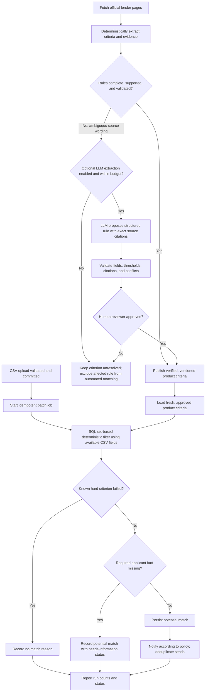

# Loan Eligibility Engine — Local-First Implementation Plan

## Goal

Deliver the complete assignment pipeline, starting with a working local implementation. Keep the application portable so the same CSV ingestion, PostgreSQL schema, and n8n workflows can later use AWS S3, Lambda, RDS PostgreSQL, and SES. AWS deployment is a later milestone; public AWS deployment is optional in the assignment.

## Phase 1 — Local development foundation

Use Python for the upload/ingestion service and Docker Compose for the local stack:

- **Upload service/UI:** a minimal browser page to select and upload CSV files; a Python API validates uploads and creates an upload-batch record.
- **PostgreSQL:** store upload batches, users, discovered loan products, and user-product matches. Include schema migrations and indexes for eligibility filters.
- **n8n:** self-hosted in Docker Compose, with persistent storage and an encryption key. Keep exported workflow JSON files in the project.
- **Local file storage:** save uploads under a configurable local data directory. Process each upload, persist valid users, then call the matching workflow webhook. This preserves the event boundary needed for the later S3-to-Lambda adapter without requiring AWS locally.
- **Configuration:** provide `.env.example`; keep database passwords, LLM credentials, and email credentials out of source control.

Use the repository's `users.csv` as the initial fixture. Validate required headers and types, report row-level errors, and make retries idempotent so duplicate uploads do not create duplicate users or notifications.

## Phase 2 — Product discovery (n8n Workflow A)

For the first demo, assume the sample income values are monthly INR and users are in India. The CSV does not specify country or currency, so keep this assumption explicit in configuration and add country/currency fields before supporting other markets.

Use these lender-owned sources as the initial allow-list; rate and eligibility facts may live on separate pages:

- **SBI:** [Personal loan product and eligibility](https://sbi.bank.in/web/personal-banking/loans/personal-loans/sbi-personal-loan) and [personal loan scheme interest rates](https://sbi.bank.in/web/interest-rates/interest-rates/loan-schemes-interest-rates/personal-loans-schemes).
- **HDFC Bank:** [Personal loan product and eligibility](https://www.hdfc.bank.in/personal-loan) and [interest rates and charges](https://www.hdfc.bank.in/personal-loan/interest-rates-and-charges).
- **ICICI Bank:** [Personal loan eligibility](https://www.icici.bank.in/personal-banking/loans/personal-loan/eligibility) and [interest rates](https://www.icici.bank.in/personal-banking/loans/personal-loan/personal-loan-interest-rates).

Before enabling a source, confirm that its current pages still cover the same product, check the lender's crawling terms/robots policy, and record canonical URLs without tracking parameters. Crawl these pages once daily, with low request rates and retries for temporary failures.

For every extracted field, save the lender, product, source URL, page title, exact supporting text snippet, fetch time, source-published/effective date when present, validity period when present, and a content hash. Store eligibility separately by applicant segment (for example, salaried vs. self-employed) and preserve unknown or conditional terms as unknown/conditional rather than inventing a hard threshold.

Keep advertised starting rates, published rate ranges, realized quarterly rates, and APR as distinct values with their own labels and periods. Do not present a starting rate as the user's expected offer or compare APR directly with a nominal interest rate. Use deterministic extraction where possible; an LLM may help parse unstructured wording, but it must not create a value without a supporting lender-page snippet.

Validate each fetch and extraction before updating the live product record. If a page fails, changes unexpectedly, omits a required value, or produces unsupported/ambiguous data, retain the last known record with its previous provenance, mark it unverified/stale, and exclude it from new match emails after 48 hours without a successful verification. Flag material changes or failed validation for review; never replace a valid value with a guessed value or a blank. Show the source link and last-checked date with each product, and state that matches are indicative only—the lender makes the final eligibility and rate decision.

## Phase 3 — Eligibility matching (n8n Workflow B)

Trigger matching only after an upload batch and its valid applicant rows have committed successfully. The current CSV contract is exactly `user_id`, `name`, `email`, `monthly_income`, `credit_score`, `employment_status`, and `age`. Design the initial matcher around only these fields. n8n should coordinate the job; PostgreSQL should do the bulk filtering and matching work. Do not fetch all applicants and products into n8n and evaluate their Cartesian product there.

For eligibility decisions, use `monthly_income`, `credit_score`, `employment_status`, and `age` only where the lender publishes an applicable criterion. `user_id` is an identifier for linking results; `name` and `email` are for display/notification only and must not be sent to an LLM or included in eligibility predicates. The current CSV does not provide country, currency, income net/gross basis, employer sector, tenure, or salary-account status. Retain the explicit local assumption that the sample data is monthly INR and India, and represent unsupported lender conditions as unknown / needs confirmation. Do not infer these missing facts from a person's name, email, or other fields.

### Matching stages

1. **Create an idempotent job.** Pass the batch ID and a unique run/chunk ID through the webhook. Record job status, attempts, timestamps, and progress so a retry can resume safely. A duplicate webhook must not duplicate match rows or notifications.
2. **Select usable products.** Match only products with validated criteria and a successful source check within the freshness window (48 hours for this demo). Keep criteria version and source evidence timestamp with the run. Exclude stale or unverified products.
3. **Apply a set-based SQL prefilter.** Join applicants from the requested batch directly to active product rules. Filter on the available fields: normalized employment segment, age bounds, monthly income minimum, and any lender-published numeric credit-score bounds. Treat the monthly income comparison as an assumed monthly INR comparison for this demo; where the lender specifically requires net salary and the CSV does not say gross or net, preserve that condition as unresolved even when the numeric amount exceeds the threshold. Apply no predicate to `user_id`, `name`, or `email`. Use `NOT EXISTS` or a unique constraint to skip pairs already processed for the same product criteria version. Return only candidate pairs and unresolved criteria; do not issue one database query per applicant/product pair.
4. **Classify results explicitly.** A known hard-rule failure is a rejection. Passing all known hard rules creates a potential match. A missing required fact (for example, net-versus-gross income, sector, tenure, or salary-account relationship) becomes `needs_information`/`needs_review`; missing data is never treated as a pass. Keep lender-specific unknowns distinct from hard failures.
5. **Persist in bulk.** Use `INSERT ... SELECT ... ON CONFLICT DO NOTHING` (or an equivalent bulk operation) to persist potential matches and unresolved outcomes. Store applicant, product, batch, criteria version, deterministic reason codes, and timestamps. Keep user-facing explanation text separate from fields that determine eligibility.
6. **Orchestrate downstream work.** n8n starts the optional review stage only when needed, then starts notifications only for persisted outcomes allowed by the notification policy. Notification state and an idempotency key prevent duplicate sends after retries.

### SQL-first reduction for the current CSV

The naive comparison count is `N applicants × P products`. For the current contract, eligibility can be evaluated using a small, fixed set of typed facts: normalized employment status, age, monthly income, and credit score. Evaluate those facts in one database query over the batch and the active product rules; do not ask an LLM to compare applicant/product pairs. `user_id` links the result, while name and email are excluded from the decision path. The database should apply deterministic rules first so any later expensive step sees only the reduced candidate set `C`. For example, after mapping the lender's criteria into a relational rule set:

```sql
INSERT INTO loan_matches (...)
SELECT a.id, p.id, a.batch_id, ...
FROM applicants AS a
JOIN loan_products AS p
  ON p.status = 'verified'
 AND p.last_checked_at >= :freshness_cutoff
JOIN product_eligibility_rules AS r
  ON r.product_id = p.id
 AND r.criteria_version = p.criteria_version
 AND a.employment_segment = r.employment_segment
WHERE a.batch_id = :batch_id
  AND a.monthly_income >= r.minimum_monthly_income_inr
  AND a.age BETWEEN r.minimum_age AND r.maximum_age
  AND (r.minimum_credit_score IS NULL OR a.credit_score >= r.minimum_credit_score)
  AND NOT EXISTS (
      SELECT 1 FROM loan_matches AS m
      WHERE m.applicant_id = a.id
        AND m.product_id = p.id
        AND m.criteria_version = p.criteria_version
  )
ON CONFLICT DO NOTHING;
```

This is a query pattern, not a claim that every lender publishes every field. Final predicates must reflect verified lender criteria. The sample's monthly INR/India assumption is not an applicant-provided fact; if the system later accepts other markets, add and validate country/currency columns before matching those users. Missing or conditional criteria should create an unresolved outcome rather than being omitted or guessed. The current product criteria are JSONB and the current applicant fields are limited; keep source evidence in its provenance record, and promote frequently filtered, well-defined rules into typed columns or normalized, versioned rule tables. Add applicant fields (such as net monthly salary, employer sector, and employment tenure) only as a separately versioned CSV/API contract change. Represent “not supplied” separately from `false`.

Normalize `employment_status` once during ingestion into a controlled segment value used by SQL (for example, `salaried` or `self_employed`); retain the submitted value for traceability. Avoid applying `lower()`, wildcard matching, or custom normalization repeatedly on every row in the hot matching query. Reject or flag statuses that cannot be mapped unambiguously. Use a fixed rule evaluation to produce both the outcome and reason codes: failed hard rule = no match; all available hard rules pass = potential match; a lender requirement cannot be checked from these CSV columns = potential match with an explicit unresolved check, or needs-information status according to product policy. Never claim full eligibility when a required condition is unknown.

Add indexes to support measured join and filter patterns: applicants by `(batch_id, employment_segment)` and selectively by common numeric bounds; product rules by status/product/version/segment; and matches by a unique applicant/product/criteria-version key plus batch ID. Validate with `EXPLAIN (ANALYZE, BUFFERS)` on representative data before adding more indexes, since indexes also increase import and storage costs. For larger batches, use bounded, resumable chunks and keyset pagination; consider partitioning only when measurements show it is needed.

### LLM boundary and cost controls

The default and intended path for this CSV makes **zero LLM calls**. Every applicant-side factor currently supplied is structured and can be filtered deterministically in PostgreSQL. An LLM adds latency and cost without adding reliable information for these fields. Name and email are not eligibility inputs and must not be sent to a model. If a lender criterion cannot be assessed from the current CSV, record it as unknown and either request that fact in a future schema version or show it as a lender-confirmation item; do not spend an LLM call trying to infer it.

The explicitly approved optional LLM phase is limited to product-side official-source text that deterministic extraction cannot reliably structure. Examples include: a prose rule whose linked page adds an exception that changes how it applies; a table whose footnote qualifies an income or employment threshold; conflicting criteria on two official pages where the applicable product rule is unclear; or vague language such as “eligibility may vary by profile” that gives no usable threshold. These are product-data extraction/review cases, not reasons to run a model once per applicant/product pair. First try deterministic parsing and validation. The implemented Gemini path proposes a structured rule from the specific official text, attaches exact source URLs/snippets, and routes the proposal for human validation before it can affect matching. If the official text remains unclear, leave the criterion unresolved rather than guessing. Keep applicant PII out of prompts. The model is a review aid, not the source of lender rules or an approval decision.

Because the current matching path does not need an LLM, applicant-matching LLM spend is zero. The approved product-data proposal path caches results by source content hash and records model/token metadata; add explicit per-run call/token/spend caps before enabling broader or scheduled use. Do not create applicant-level LLM work or send personal data to achieve a smaller candidate set.

### End-to-end flow, including the optional LLM branch

The LLM branch is a separate **product-criteria extraction/review flow**. It does not receive CSV applicants and does not run once per candidate pair. Deterministic extraction and validation run first. Clear, supported rules go directly to the matcher; only ambiguous official-source text may be sent for an LLM proposal, which must be human-approved before becoming an active rule version.



With the current CSV, the SQL matcher uses only monthly income, credit score, normalized employment status, and age when the verified product criteria include those conditions. `user_id` is only a linking identifier; name and email are not sent to the LLM or used for eligibility. If a criterion is unknown because the CSV lacks a required fact, the system records that limitation rather than calling an LLM to infer it. Thus the optional LLM branch can improve product-rule extraction quality, but the current applicant-matching path remains deterministic and has zero LLM calls.

### Baseline approach vs. proposed approach

| Area | Previous local implementation | Proposed approach | Value of changing |
| --- | --- | --- | --- |
| Filtering | SQL narrows applicants by batch and some numeric rules for each product/segment; employment-status normalization and several checks happen in Python. | PostgreSQL evaluates the batch against versioned product rules in a set-based query, including normalized employment segment and available numeric criteria. | More of the work runs close to the data, with fewer records transferred to Python and less per-candidate application work. |
| Database calls | The endpoint loops through products and segments, fetches candidate applicants, and checks for an existing match per candidate. | One set-based candidate/persistence operation (or bounded chunk operations for large batches), with conflict handling for duplicates. | Reduces repeated query round trips and makes runtime less sensitive to the number of candidate pairs. |
| Persistence | Match objects are added during Python iteration and committed at the end; a unique constraint helps protect against duplicates. | Bulk `INSERT ... SELECT ... ON CONFLICT` stores outcomes with criteria version, statuses, and reason codes. | Improves retry behavior and provides a consistent, auditable record of which rules produced each outcome. |
| Criteria representation | Product rules are held in JSONB and interpreted in application code. This is flexible and quick to change for the local demo. | Frequently evaluated rules are mapped into typed, versioned columns or normalized rule tables; source evidence remains attached to the product record. | Supports predictable SQL joins, clearer data validation, and targeted indexing as the number of products/rules grows. It requires more schema and migration work. |
| Unavailable facts | The current code adds lender-specific follow-up notes for facts absent from the CSV, but the match record is still a potential match. | Persist a distinct unresolved/needs-information state and keep it separate from hard-rule failure and potential match. | Makes the result easier to interpret and prevents an informational match from being mistaken for fully checked eligibility. |
| LLM usage | No LLM is called by matching. | Continue with zero applicant-level LLM calls; only consider a separately approved, evidence-backed product-rule extraction review for genuinely ambiguous source text. | Keeps matching latency and model spend at zero while preserving a controlled path for hard-to-parse product data. |
| Operational scale | Straightforward for a few products and demo-sized batches; the code is easy to follow locally. | Add measured indexes, job status, bounded/resumable chunks, and query-plan tuning as actual volume requires. | Improves throughput and recovery at larger volumes, without paying the operational cost of queues/partitioning before evidence justifies them. |

**Previous approach strengths:** it was deterministic and LLM-free; simple to run locally; JSONB criteria were flexible while the product set was small; and the unique constraint provided a basic duplicate safeguard. For the current 10,000-row sample and three initial lenders, it may have been adequate as a demonstration, so a rewrite should be justified by measurements rather than assumed to be faster in every environment.

**Previous approach limits:** work was organized around product/segment loops, some filtering ran in Python after fetching rows, and duplicate checks were issued for candidate pairs. As users, products, or rule segments increase, that creates more application work and database round trips. JSONB rules are less convenient to validate, join, and index consistently. The previous match result also did not model “unknown required fact” as a first-class status, which could make a potential match look more conclusive than the CSV supports.

**Why the proposed change is meaningful:** it changes the work from repeatedly fetching and checking individual candidates to a database set operation over a batch, and it makes rule versions, unresolved facts, and idempotent persistence explicit. Expected value is lower query/transfer overhead, more predictable growth as `N` and `P` rise, simpler retries, and clearer auditability—not a guarantee of a particular speedup. Before and after implementation, measure batch duration, SQL statement count, rows returned to the application, candidate reduction ratio, database CPU/IO, and duplicate/retry behavior on representative data. If those measurements show the current path is comfortably within target, retain it until scale or product complexity warrants the added normalized-rule schema and migration effort.

### Scale and operational rollout

- First measure current duration, query count, candidate reduction ratio, and database load on representative batches.
- Replace per-product/per-applicant loops and per-pair existence lookups with set-based filtering and bulk persistence.
- Formalize frequently used hard criteria into typed, versioned rules while retaining source provenance and unresolved conditions.
- The local implementation now has a durable match-job table, advisory locking, criteria-version idempotency, progress counters, and bounded 1,000-row insert transactions. Add fault-injection checks for process interruption and retry recovery before treating this as production-grade resume behavior.
- Add the optional LLM review stage only after recording the deterministic candidate volume and demonstrating a real use case. Track latency, cost per batch, candidate-to-review ratio, and review outcomes.
- Keep an audit trail of the batch, applicant/product IDs, criteria version, source freshness, rule outcomes, unresolved fields, and any LLM review metadata so every result can be reproduced and explained.

The local matching endpoint now uses one PostgreSQL set-based candidate query, normalized employment-segment values, and bounded bulk inserts with conflict handling. It stores `potential` versus `needs_information` on each saved match. Existing local databases are backfilled at startup. Product criteria remain JSONB. The optional Gemini source-text proposal branch now runs after deterministic extraction only when `LLM_API_KEY` is configured and required criteria remain unstructured; it validates exact source quotes, stores proposals inactive, and exposes them through a review-queue API connected to Workflow A. Human approval is required before criteria can become verified/matchable. Proposals are cached by source content hash to avoid repeated calls for unchanged pages. Applicant matching itself remains deterministic and makes zero LLM calls. The present CSV's eligibility inputs are only monthly income, credit score, employment status, and age. Sector, salary-account status, tenure, net/gross income basis, country, and currency are absent from the file; keep the local INR/India assumption explicit and those lender-specific conditions unresolved. Names and emails must never affect match decisions.

### Workspace implementation audit — 19 Oct 2026

This section records implementation and local runtime evidence collected on 19 Oct 2026. “Implemented” means code/configuration exists; “runtime verified” means the local service or workflow was observed completing. Runtime figures are local demonstrations, not production benchmarks.

| Plan item | Status | Workspace evidence / remaining work |
| --- | --- | --- |
| Basic local React UI, API, PostgreSQL, n8n, Mailpit | Implemented; services running | `frontend/src/App.tsx`, `frontend/src/styles.css`, `backend/app/main.py`, `docker-compose.yml`; API health returned `ok`, and Compose showed all five services up. PostgreSQL is exposed on host port 5433 in this workspace. React TypeScript/Vite production build succeeds. The UI now uses ClickPe's published blue/navy/green identity and logo. |
| CSV contract, validation, persistence, duplicate-file handling | Runtime verified for the provided fixture | `users.csv` has 10,000 rows. Upload batch `2001e55c-4dda-4874-a8fd-35cc40ddebc3` reports 10,000 imported and 0 rejected. The endpoint records content hashes and row-level errors. |
| Deterministic lender discovery and source provenance | Partially runtime verified | Workflow A ran successfully in the prior local run. At audit time, SBI and HDFC were `verified` and fresh; ICICI was `stale` after required eligibility evidence was not extracted. The review queue returned 0 items. A single successful run does not establish reliable daily crawling or resilience to source layout changes. |
| Gemini criteria proposal and human-review gate | Implemented; runtime verified; human decision still pending | `backend/app/discovery.py` uses `gemini-flash-latest`; `backend/app/main.py` validates and queues proposals with source-hash/freshness checks. Workflow A execution `9` created one ICICI proposal from the official eligibility page, retaining 5 exact-quote evidence entries and 4,539 reported total tokens. The proposal is surfaced in the React **Criteria review** section at `http://localhost:5173` and in `GET /api/products/review-queue`; it is not a popup inside n8n. The React reviewer actions were initially greyed out while the token field was empty; they now remain clickable and explain how to supply the token, while API errors (invalid token, changed source, expired evidence) are shown inline. Workflow A generates the proposal; a person decides in React using the local review token from `.env`. The queue still has one pending proposal; ICICI remains stale/excluded from matching until a human approves it. |
| SQL-first matching and bulk persistence | Runtime verified on one 10k-row batch | Workflow B execution `7` succeeded. It checked 10,000 applicants against 2 verified products, evaluated 6,778 candidate pairs, and created 6,778 match rows in approximately 2.08 seconds. Relative to the simple 10,000 × 2 = 20,000 applicant/product baseline, this is 13,222 fewer pairs (66.11% fewer; 33.89% remained). This ratio and timing are specific to the fixture, current product rules, local Docker/host, and current database state; they are not a general throughput guarantee. |
| Match outcome quality and unavailable fields | Runtime verified; input contract limitation remains | All 6,778 saved rows were `needs_information`, consistent with lender criteria that require applicant facts absent from the CSV (for example sector, service tenure, net-income basis, or salary-account relationship). This is not an eligibility approval. The source CSV does not contain those fields; do not infer them. |
| Durable matching jobs, bounded inserts, criteria-version idempotency | Implemented; runtime verified | `backend/app/main.py` defines `MatchJob`, persists attempts/status/timestamps/progress/results, takes a PostgreSQL advisory lock, and inserts in chunks of 1,000. A unique `(applicant_id, product_id, criteria_version)` key allows a changed rule version to be evaluated separately. The 12-applicant validation batch recorded a completed job with 24 candidate pairs, 24 created matches, and 24 `needs_information` outcomes. Job state is available at `GET /api/workflows/match-jobs?batch_id=...`. Resuming an interrupted multi-chunk job after process death still needs a dedicated fault-injection acceptance check. |
| Notification workflow and local delivery | Runtime verified end to end | The earlier 10,000-row notification execution `8` eventually completed, and database status later showed all 6,778 match rows sent to the controlled local test inbox. Synthetic batch `ed9bc194-649e-4a32-aeaa-896ccfc87267` exercised current Workflow B execution `12` and bounded Workflow C executions `13` and `14`: 12 applicant emails were delivered to the configured Mailpit test recipient, all 24 associated match rows transitioned to `sent_to_local_test_inbox`, and none remained pending. Applicant CSV email addresses are not used as destinations. |
| Scale-safe notification batching and duplicate-send controls | Implemented; multi-page runtime verified | `backend/app/main.py` claims applicant notifications with a lease, bounded page size (default 10, maximum 25), a per-batch cap (default 25), and claim IDs. Workflow C retries SMTP up to three times, acknowledges completion by claim ID, and recursively starts another page only when work remains. The 12-recipient run required two API page fetches (10 then 2) and completed 12 messages / 24 match rows. SMTP acceptance followed by a lost acknowledgement can still lead to a resend after the 15-minute lease expires; exactly-once SMTP delivery cannot be guaranteed. |
| Workflow evaluation suite | Implemented; 10 checks pass | `backend/evals/test_workflow_evals.py` covers mocked Gemini evidence/source validation and PII boundaries, deterministic matching rules and invalid inputs, controlled-recipient email construction, and workflow-export topology. Run with `python -m pytest evals -q` from `backend`; the local run passed 10 tests. These are focused evaluations, not exhaustive production acceptance tests. |
| Managed schema migrations and production operations | Not implemented | Local database backfills/index setup run at API startup. Production rollout still needs versioned migrations, observability, backup/restore procedure, secrets management, and load tests. |
| AWS deployment checklist | Plan only | No AWS resources or deployment templates are present in the workspace evidence reviewed. S3, presigned upload, Lambda, private RDS/VPC, EC2 n8n, IAM/Secrets Manager, SES, and CloudWatch remain later work. |

#### Evidence and audit interpretation

- The API health endpoint returned `{"status":"ok"}` during this audit; Compose showed `api`, `frontend`, `n8n`, `postgres`, and `mailpit` running.
- The upload detail endpoint reported 10,000 total/imported rows and zero rejected rows for the batch above. PostgreSQL independently reported 10,000 applicant rows.
- The original matching n8n execution `7` reported 10,000 checked applicants, 2 verified products, 6,778 candidate pairs, and 6,778 created matches. The run's candidate count is 66.11% below the simple 20,000-pair baseline for these two products.
- Notification execution `8` was still running at an earlier snapshot, but later completed successfully. The 6,778 associated match rows were subsequently observed in `sent_to_local_test_inbox`; Mailpit retains at most 500 messages in this configuration, so that run's full email archive cannot be independently reconstructed from Mailpit.
- At the initial audit snapshot, `.env` and the API container had no Gemini key. After the user added the rotated key, the API container was recreated; its environment now confirms that the key is configured, without displaying the secret. The configured model is `gemini-flash-latest`.
- Workflow A execution `9` completed successfully on the manual schedule-trigger run. Its discovery node reported SBI and HDFC verified, ICICI requiring review, and `llm_review_required: true` for ICICI. The following review-queue node returned one pending proposal.
- Gemini's persisted proposal records five source-quoted fields (age range, monthly income, work experience, and preferred credit score) from the official ICICI eligibility page and one uncertainty excluding self-employed criteria for this personal-loan product. The source hash is retained. Gemini usage metadata reports 3,247 prompt tokens, 218 candidate tokens, 1,074 thought tokens, and 4,539 total tokens. No currency cost is asserted because the run does not record billing price.
- A subsequent direct API discovery call reused the cached proposal for the unchanged source hash; changed-source invalidation still needs dedicated acceptance coverage.
- The latest API container starts cleanly and `/api/health` returns `ok`; `docker compose ps` showed API, frontend, PostgreSQL, n8n, and Mailpit running. `npm run build` completed, and `python -m pytest evals -q` passed 10 checks (two FastAPI lifecycle deprecation warnings remain).
- Synthetic batch `ed9bc194-649e-4a32-aeaa-896ccfc87267` contains 12 fabricated applicants with `.invalid` email addresses. Workflow B created 24 matches in a completed durable job; Workflow C fetched two notification pages and marked all 24 matches delivered to the controlled test inbox. The status endpoint reported 12 sent recipients and zero pending match rows.
- The pending proposal is not a verified product. ICICI remains stale with no current `last_checked_at`; the review endpoint requires current rate/source evidence and a human decision before it can become verified. Do not treat the proposal as an eligibility rule until that approval happens.

#### Remaining action items

1. A human should review the pending ICICI proposal in the React **Criteria review** panel. Confirm the quoted official-source evidence and applicable rates, then approve/reject with the review token; until then ICICI stays out of matching.
2. Add Alembic or equivalent versioned migrations. Current compatibility migrations execute during API startup, which is useful locally but does not provide controlled production rollout/rollback.
3. Add fault-injection acceptance coverage for interrupted chunked matching, repeated webhook delivery, stale notification lease recovery, SMTP failure/ambiguous acceptance, no-match batches, stale products, malformed uploads, and changed-source Gemini cache invalidation.
4. Measure SQL plans and timings at larger applicant/product counts; the 10k local fixture is a baseline only. Add indexes or partitioning only in response to query-plan and load evidence.
5. Add operational monitoring, backups/restore drills, retention policies, and AWS infrastructure only when moving beyond the local-first phase. AWS resources remain plan-only.

## Phase 4 — Notifications (n8n Workflow C)

Run after matching completes. Group new matches by user, create a concise personalized email listing matched products and published rates/criteria, then send via the n8n AWS SES node in AWS or a local SMTP test inbox during development. For the assignment demo, use controlled test inbox aliases only; never email sample CSV addresses. Store send status to prevent duplicates on retry.

## Phase 5 — Local acceptance and handoff

Run the full flow locally: start Docker Compose, upload `users.csv`, verify ingestion and database records, run product discovery, inspect matches, and show a received test email. Also check malformed rows, empty files, duplicate uploads, no-match users, stale/unverified products, missing applicant facts, duplicate webhook/retry behavior, crawl failures, notification failures, and (if later enabled) LLM budget/validation failures. For matching performance, compare candidate counts and query plans on increasingly large synthetic batches before choosing chunk sizes or adding indexes.

Deliver the Compose configuration, application source, database migrations, exported n8n workflow JSON files, `.env.example`, and a README with local setup, workflow import, credentials, troubleshooting, and an architecture diagram. Record the requested 5–10 minute walkthrough with node-by-node explanations and the complete upload-to-email demo. Submit repository and video links through the assignment form within 72 hours of receiving the assignment email.

## AWS Setup Checklist — Later Deployment

Keep resources in one AWS Region, selected near intended users and with the needed services available.

### 1. Account, access, and cost controls

- Use an AWS account you control, enable MFA for the root user, and avoid root credentials for development.
- Set up an IAM Identity Center/CLI profile or another short-lived developer access method. Avoid broad, permanent application access keys.
- Create an AWS Budget with email alerts before provisioning. EC2, RDS, NAT gateways, load balancers, and public IPv4 addresses can incur ongoing charges; stop or delete demo resources when finished.
- Deploy through the repository's `serverless.yml` so AWS resources can be recreated and removed consistently.

### 2. VPC and network access

- Create a VPC with public subnets for the n8n host and private subnets in at least two Availability Zones for the RDS subnet group.
- Run n8n on a small EC2 instance using the assignment's Docker Compose setup. Attach an instance role and administer it with Systems Manager Session Manager instead of exposing SSH.
- Give n8n a stable HTTPS webhook URL. Use a domain and TLS reverse proxy or HTTPS load balancer; restrict inbound traffic to HTTPS and protect the n8n editor with authentication.
- Keep RDS private. Allow PostgreSQL TCP 5432 only from the n8n host and ingestion Lambda security groups.
- Place the ingestion Lambda in the VPC to reach RDS. A VPC-attached Lambda does not get internet access just by using a public subnet; avoid NAT unless a function truly needs outbound internet. In this design, crawling and LLM calls run from the n8n host.

### 3. Storage and CSV event ingestion

- Create a private S3 bucket for CSV uploads. Keep Block Public Access enabled, enable default encryption, and configure CORS only for the upload origin if the browser uploads directly.
- Use API Gateway or a Lambda Function URL to issue short-lived presigned upload URLs. Upload CSV bytes directly to S3 rather than through API Gateway/Lambda.
- Configure an S3 object-created event on the incoming CSV prefix to invoke the ingestion Lambda. Grant S3 permission to invoke it and avoid triggering on output prefixes.
- The Lambda reads and validates each object, writes rows and batch status to RDS, then invokes the n8n matching webhook. Make ingestion idempotent because event delivery/retries can repeat work.
- Add an S3 lifecycle rule to delete uploaded CSVs after the chosen retention period.

### 4. Database, secrets, and permissions

- Create RDS for PostgreSQL in private subnets, with encryption and automated backups; disable public access.
- Store database credentials and the LLM API key in AWS Secrets Manager or an approved secret store. Let n8n and Lambda retrieve only the secrets they need; do not put secrets in Git, workflow exports, or plain-text deployment files.
- Use separate least-privilege IAM roles for deployment, ingestion Lambda, and n8n EC2. Limit S3 access to the upload bucket/prefix and SES access to the verified sender identity.
- Apply database migrations during deployment rather than relying on manual schema edits.

### 5. Email, logs, and operational checks

- Verify the SES sender identity. SES accounts commonly start in the sandbox; verify controlled test recipient addresses too. Request production access only if the project later needs to email unverified recipients. Never use sample CSV addresses for the demo.
- Send a test message through the SES node and confirm notifications run only after successful matching.
- Use CloudWatch Logs for Lambda errors and execution details with a sensible retention period. Check Lambda errors/throttles, S3 event delivery, database connectivity, n8n execution failures, and SES send failures during the end-to-end test.
- Check budget alerts and service charges, then remove AWS resources no longer needed.

### Planned AWS resources

**Required for the AWS version:** S3, upload URL endpoint, ingestion Lambda, S3 event notification/permission, VPC/subnets/security groups, private RDS PostgreSQL, EC2 for Dockerized n8n, IAM roles, Secrets Manager, SES, and CloudWatch Logs.

**Optional or conditional:** Route 53 domain and ACM certificate (depending on HTTPS hosting); NAT Gateway (only if a private resource needs general internet access); SQS/DLQ for buffering and replay if direct event-to-Lambda retries prove insufficient; API Gateway (a Lambda Function URL can handle the small presign request); AWS deployment itself (local deployment is accepted).

## Architecture

**Local:** Browser -> Python upload service -> local file storage -> PostgreSQL -> n8n Workflow B -> PostgreSQL matches -> n8n Workflow C -> test inbox. Workflow A runs on a schedule and updates PostgreSQL.

**AWS:** Browser -> presigned S3 upload -> S3 event -> ingestion Lambda -> private RDS -> n8n webhook/workflows -> RDS matches -> SES test email. n8n runs in Docker Compose on EC2 and reaches RDS over the VPC.

## AWS references

- [Configure S3 event notifications](https://docs.aws.amazon.com/AmazonS3/latest/userguide/enable-event-notifications.html)
- [S3 event notification destinations and delivery considerations](https://docs.aws.amazon.com/AmazonS3/latest/userguide/notification-how-to-event-types-and-destinations.html)
- [Connect Lambda to private VPC resources](https://docs.aws.amazon.com/lambda/latest/dg/configuration-vpc.html)
- [SES verified identities](https://docs.aws.amazon.com/ses/latest/dg/verify-addresses-and-domains.html)


