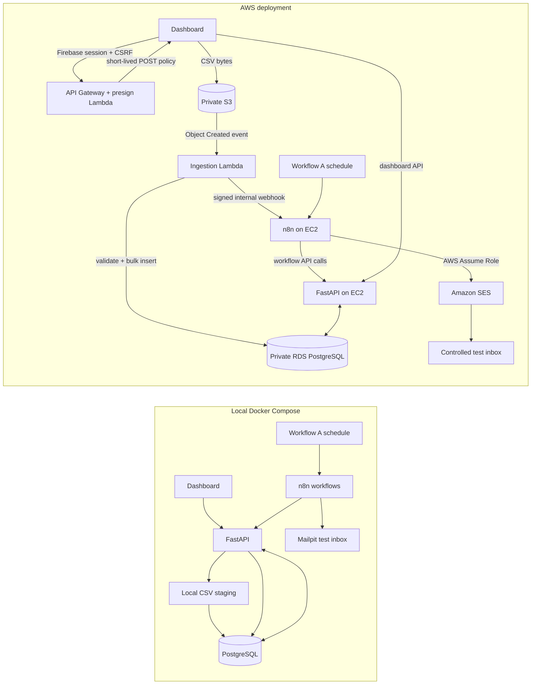

# Loan Eligibility Engine — local operations workspace

The local stack includes a React + Tailwind dashboard, FastAPI, PostgreSQL, n8n, and Mailpit. It supports CSV ingestion, deterministic SQL matching, sourced lender-product data, an optional Gemini-assisted criteria proposal that requires a reviewer, and controlled test notifications.

## 1. Configure Firebase sign-in

The Firebase web app configuration belongs in the local `.env` as `VITE_FIREBASE_*` values. These values identify the client app and are not server credentials. In Firebase Console:

1. Open **Authentication → Sign-in method** and enable **Google** (the UI currently implements Google sign-in).
2. Add `localhost` under **Authentication → Settings → Authorized domains**.
3. In **Project settings → Service accounts**, generate a Firebase Admin SDK private key. Save it as `secrets/firebase-service-account.json`. Keep this JSON private and never commit it; `secrets/` is ignored and mounted read-only into the API container.
4. Set `FIREBASE_PROJECT_ID` to the Firebase project ID and `FIREBASE_BOOTSTRAP_ADMIN_EMAIL` to the verified Google account that should become the first workspace and criteria administrator. This is the app administrator account, separate from the n8n owner account.

The API creates an HttpOnly Firebase session cookie after verifying the ID token and verified email. New users need a workspace invite; the configured bootstrap admin is provisioned automatically. Workspace admins can invite analysts or viewers in **Team & access**; the platform admin can grant or remove criteria-review access for workspace members there. Criteria approval uses the signed-in platform reviewer role; there is no pasted review token.

## 2. Configure local services

1. Copy `.env.example` to `.env` (or keep your existing `.env`) and set a strong local PostgreSQL password, `N8N_ENCRYPTION_KEY`, Firebase settings above, and a random `N8N_SERVICE_TOKEN` of at least 32 characters. Keep `.env` private.
2. Set `NOTIFICATION_TEST_RECIPIENT=test@clickpe.dev` to enable local test email. Messages go to Mailpit at http://localhost:8025; they are not delivered to the external address and CSV applicant addresses are never used as recipients.
3. Start/rebuild from the project root: `docker compose up --build -d`.
4. Open the dashboard at http://localhost:5173, API docs at http://localhost:8000/docs, n8n at http://localhost:5678, and Mailpit at http://localhost:8025. PostgreSQL is exposed on host port `5433` (container port `5432`).

The API reads Firebase Admin credentials from `/run/secrets/firebase-service-account.json`. If the local credential file or bootstrap email is absent, Firebase sign-in/workspace provisioning cannot complete; the Operations screen reports Firebase readiness.

## 3. n8n workflows

Import the three JSON files from `workflows/` if starting with an empty n8n volume:

- `product-discovery.json` — daily lender source refresh and criteria-review queue.
- `user-loan-matching.json` — new-batch webhook, set-based SQL matching, and notification handoff.
- `user-notifications.json` — bounded messages delivered through Mailpit locally or SES on AWS.

Assign an SMTP credential to the notification email node with host `mailpit`, port `1025`, and no TLS/authentication. The active local workflows have been updated to read `N8N_SERVICE_TOKEN` from the n8n runtime environment for API calls. Do not put this token into workflow JSON. Recreate/restart n8n after changing `.env` so the container receives the token. Workflow exports use the same environment expression and contain no key value.

Workflow exports are inactive; after importing into a fresh n8n volume, assign the Mailpit credential and activate the schedule and webhook workflows.

## Dashboard pages

- **Overview:** workspace run counts, applicants, potential matches, attention items, active matching jobs, and recent runs.
- **Runs:** searchable paginated history.
- **Run detail:** accepted/rejected rows, live matching state, event timeline, criteria versions, match outcomes, and bounded notification progress.
- **New upload:** CSV upload progress and automatic navigation to the created run.
- **Products:** published lender criteria, source links, and freshness state.
- **Criteria review:** proposal, evidence quotes, source links, uncertainties, and approve/reject confirmation. Approval validates the proposal hash and current source evidence on the server.
- **Operations:** API-visible database, Firebase Admin, n8n, and the selected local notification transport.
- **Team & access:** invite verified Firebase accounts as analysts or viewers.

## Input and matching contract

CSV columns required: `user_id,name,email,monthly_income,credit_score,employment_status,age`. Uploads are UTF-8 CSV up to 25 MB. Invalid rows are reported per run; identical file content within a workspace reuses the existing batch. The initial sample is `users.csv` (10,000 rows).

Matching uses a database-side candidate filter and idempotent bulk persistence. Applicant data is not sent to Gemini. Missing factors such as employment tenure, salary-account relationship, sector, or net/gross income basis remain explicit follow-up checks. A potential match is not a lender approval or offer. The local example assumes monthly INR and India.

Lender discovery first uses deterministic extraction from configured official sources. Gemini may propose typed criteria only when required product facts cannot be reliably structured deterministically; proposals remain inactive until a platform reviewer approves them. Never commit `LLM_API_KEY`.

## Architecture



The n8n workflows orchestrate discovery, matching, and notifications. The API owns database transactions, row validation, SQL candidate filtering, and safe test-recipient construction; workflows call its authenticated internal endpoints. Matching first applies income, score, employment, and age criteria in PostgreSQL, then records outcomes with criteria versions. Applicant records are not sent to the LLM. This keeps pair evaluation set-based and avoids an LLM call for each user/product pair.

### Workflow and filtering details

- **Workflow A — discovery:** a daily schedule fetches the allow-listed lender pages (SBI, HDFC, and ICICI), extracts product/rate/eligibility facts, stores deterministic results with source links and freshness, and queues incomplete Gemini-assisted criteria for a human reviewer. Unapproved or stale criteria stay out of matching.
- **Workflow B — matching:** an authenticated batch webhook calls the API's matching operation, which applies SQL filters and persists matches in chunks under criteria-version uniqueness. This keeps the authoritative user data and transaction logic inside the API/PostgreSQL boundary while n8n controls the sequence and retry entry point.
- **Workflow C — notification:** after matching, the workflow claims a bounded page, creates one test-inbox message per applicant, branches to SES or Mailpit, acknowledges each delivery, and requests another page only when the claim says work remains. The destination comes from `NOTIFICATION_TEST_RECIPIENT`; applicant CSV emails are never used.

The local 10,000-row evidence recorded 6,778 candidate pairs against two verified products, versus 20,000 pairs in a naive all-pairs pass: 66.11% fewer pairs, with 6,778 database inserts in about 2.08 seconds on that local fixture. All saved rows needed additional information because the sample CSV lacks lender-specific fields such as tenure or salary-account relationship. This is a fixture-specific baseline, not an AWS capacity guarantee or a loan approval result. See [PLAN.md](PLAN.md) for the fuller audit and limits.

## AWS deployment mode

The AWS files are included but have not been deployed from this workspace. They provision a private encrypted S3 bucket, event-driven ingestion Lambda, API Gateway presign endpoint, private PostgreSQL RDS, private VPC subnets and endpoints, CloudWatch logs and a dead-letter queue, an SES sender identity, and an IAM role/profile for an n8n EC2 host. The EC2 instance itself is created by you so you can choose its size and control its lifetime. AWS resources can incur charges; remove the stack and EC2 host when the demo is finished.

### 1. Prepare credentials and DNS

1. Copy `.env.example` to `.env`; leave local settings as needed and fill the AWS settings for your account. Keep `.env` private. The Serverless Framework v3 config loads this file with `useDotenv: true`.
2. Configure AWS CLI credentials using your own short-lived deployment access. Choose one AWS Region for the stack, the API Gateway custom-domain ACM certificate, and SES.
3. Create two Secrets Manager secrets in that Region: one whose secret string is the raw Firebase Admin service-account JSON, and one whose secret string is the same random `N8N_SERVICE_TOKEN` used by the API and n8n. Set `FIREBASE_SERVICE_ACCOUNT_SECRET_ARN`, `FIREBASE_PROJECT_ID`, and `N8N_SERVICE_TOKEN_SECRET_ARN` in `.env`. Do not paste the JSON or token into workflow exports or commit them.
4. Set `APP_ORIGIN` to the full HTTPS dashboard origin. Set `APP_DOMAIN`, `API_DOMAIN`, and `N8N_DOMAIN` to DNS names under the same parent domain so the secure Firebase session cookie can be shared. Set `SESSION_COOKIE_DOMAIN` to that parent domain, including its leading dot. Set `UPLOAD_API_DOMAIN` and provide an ACM certificate ARN in the selected Region. Add `SES_FROM_EMAIL`, which the stack registers as an SES identity.
5. In Firebase Authentication, add the dashboard domain to authorized domains and use a verified bootstrap administrator email. Set the `FIREBASE_BOOTSTRAP_ADMIN_EMAIL` and public `VITE_FIREBASE_*` web settings in `.env`. Choose `NOTIFICATION_TEST_RECIPIENT` as an inbox you control; never use sample CSV addresses.

The app/API/n8n hostnames need DNS records pointing to the EC2 host. The upload API hostname needs a CNAME to the `UploadApiRegionalDomain` stack output; use `UploadApiRegionalHostedZoneId` if your DNS provider accepts alias records.

The upload API validates the Firebase session cookie, CSRF token, workspace membership, file name, and reported size before issuing a ten-minute S3 presigned POST policy capped at 25 MB. The S3 event worker validates the actual object and uses the same CSV validator as the local API. AWS mode disables the API's direct body upload route.

### 2. Deploy AWS resources

From the repository root, with AWS credentials configured and `.env` filled, deploy a lowercase stage name:

```sh
npx --yes serverless@3 deploy --stage demo --region ap-south-1
```

Record the stack outputs: `UploadBucketName`, `DatabaseHost`, `DatabaseSecretArn`, `UploadApiUrl`, `UploadApiRegionalDomain`, `UploadApiRegionalHostedZoneId`, `VpcId`, `PublicSubnetId`, `N8nWorkflowSecurityGroupId`, `N8nInstanceProfileArn`, `N8nSesRoleArn`, `N8nSystemCredentialsExternalId`, and `UploadIngestionDlqUrl`. RDS generates and manages the master credential in Secrets Manager; retrieve it directly into the private host `.env` for the API container. Do not put the value into shell history or this repository.

### 3. Start n8n and the API host

1. Launch a small EC2 instance in `PublicSubnetId`, attach `N8nWorkflowSecurityGroupId` and `N8nInstanceProfileArn`, require IMDSv2 with a response hop limit of 2 for the Dockerized n8n credential provider, and use Systems Manager Session Manager for administration. The security group opens HTTP/HTTPS publicly, allows the matching Lambda to call n8n on port 5678, and does not open SSH. Assign a stable public address and point the dashboard/API/n8n DNS records to it.
2. On the instance, install Docker Engine and the Docker Compose plugin, check out this repository, and create a private `.env`. Set the RDS host, database name, master username/password, the shared cookie domain, app/API/n8n/upload API domains, Firebase values, SES sender, controlled `NOTIFICATION_TEST_RECIPIENT`, `N8N_ENCRYPTION_KEY`, and `N8N_SERVICE_TOKEN`. Place the Firebase Admin JSON at `secrets/firebase-service-account.json` with restricted file permissions; the API container mounts it read-only. Set `APP_ORIGIN` to the dashboard HTTPS origin.
3. Set `N8N_MATCH_WEBHOOK` in the deployment `.env` to `http://<EC2-private-IP>:5678/webhook/loan-match`. This private route is reachable from the VPC ingestion Lambda; do not point the Lambda at the public editor URL. The AWS compose file builds the frontend in S3 upload mode and derives `VITE_UPLOAD_PRESIGN_URL` from `UPLOAD_API_DOMAIN`.
4. Start the AWS compose stack: `docker compose -f docker-compose.aws.yml up --build -d`. The API applies Alembic migrations at startup before it serves requests. Caddy obtains HTTPS certificates once DNS points at the instance and ports 80/443 are reachable.
5. Finish `serverless deploy` again after setting `N8N_MATCH_WEBHOOK`, so the ingestion Lambda gets the internal webhook URL. The frontend image includes the upload endpoint at build time, so rebuild it if its domains or Firebase web settings change.

### 4. Import and configure n8n workflows

Import `workflows/product-discovery.json`, `workflows/user-loan-matching.json`, and `workflows/user-notifications.json` into the n8n editor, then activate them. Exports are intentionally inactive until credentials and URLs are configured.

- Workflow A runs on its daily schedule and updates product criteria through the API. Configure any optional LLM credential/key in the API environment; generated criteria remain pending human review.
- Workflow B uses the `loan-match` production webhook. The ingestion Lambda sends the internal service token; the workflow passes it to the API for its set-based matching operation.
- Workflow C's AWS SES node uses the EC2 instance role. In n8n, create an **AWS (Assume Role)** credential with the stack output `N8nSesRoleArn`, the output `N8nSystemCredentialsExternalId`, and **Use System Credentials** enabled; choose the deployed AWS Region and assign this credential to **Send through AWS SES**. The compose file enables system credentials access. Restrict n8n owner/editor access to trusted operators because anyone able to create this credential can use the host identity. Set `LOAN_NOTIFICATION_TRANSPORT=ses` and verify the SES sender and test recipient as required by your SES account mode. See [n8n AWS credentials](https://docs.n8n.io/integrations/builtin/credentials/aws/) and the [AWS SES node](https://docs.n8n.io/integrations/builtin/app-nodes/n8n-nodes-base.awsses/).

The AWS workflow n8n does not need direct database credentials: it calls the API, which owns the PostgreSQL connection. In local mode, assign the SMTP node a Mailpit credential (`mailpit:1025`, no TLS or authentication). In AWS mode, assign the IAM role credential to SES. Neither path uses CSV applicant email addresses as the destination.

### 5. Verify the live demo and clean up

Run Workflow A, upload the provided CSV from the dashboard, inspect the import/matching run, and confirm one notification in the controlled inbox. Show a test email in the 5–10 minute demonstration video. Also show Workflow A, B, and C nodes and explain the SQL pre-filter and why there is no per-pair LLM request. This workspace has not recorded a video or sent a live SES email.

When done, delete the EC2 host, empty the S3 upload bucket if unprocessed objects remain, then run `npx --yes serverless@3 remove --stage demo --region ap-south-1`. Check the stack for retained or manually-created data before deletion. RDS currently has a `DeletionPolicy: Delete`; the S3 bucket expires staged incoming files after seven days.

### Remaining account actions

The private GitHub repository and collaborator invitations, deployment to your AWS account, the SES inbox demonstration, video recording/hosting, and the assignment submission form require your account access. Invite `ujjwalkala-clickpe`, `HarshSrivastav-Dailype`, `ManishBiswal-clickpe`, and `tushar-clickpe` after making the repository private. Submit the repository and video links through the [assignment form](https://docs.google.com/forms/d/e/1FAIpQLSe1ET4U8rOcPM3VGJ8fT5HhigTO9fKuDlsB_wHtB5acWys9XQ/viewform). These account actions have not been performed from the workspace.

## API overview

- `GET /api/health` — basic API/database health and Firebase configuration indicators.
- `GET /api/operations/health` — authenticated service health used by the dashboard.
- `POST /api/auth/session`, `POST /api/auth/logout`, `GET /api/me` — Firebase session exchange and current workspace profile.
- `POST /api/uploads` — local-mode upload endpoint; AWS mode disables it so browsers use S3 direct upload. `GET /api/uploads/by-content/{sha256}` polls the workspace-scoped result after S3 ingestion.
- `GET /api/uploads`, `GET /api/runs`, `GET /api/runs/{batch_id}` — workspace-scoped run history.
- `GET /api/dashboard/summary` — workspace KPI and active-job data.
- `GET /api/products`, `GET /api/products/review-queue`, `POST /api/products/{product_id}/criteria-review` — lender catalog and role-controlled review.
- `/api/workflows/*` — n8n service operations protected by `X-Workflow-Token`; browser actions that start test delivery also require a Firebase session and CSRF check.

## Troubleshooting

- **Sign-in says no workspace:** verify the email matches `FIREBASE_BOOTSTRAP_ADMIN_EMAIL`, or invite that email from an existing workspace administrator.
- **Firebase Admin not configured:** check project ID and the mounted `secrets/firebase-service-account.json`; restart the API after changes.
- **n8n calls return 401:** ensure `.env` has a long random `N8N_SERVICE_TOKEN`, then recreate the n8n and API containers with `docker compose up --build -d api n8n`.
- **n8n SMTP node fails:** recreate/select its Mailpit credential and confirm `mailpit:1025`.
- **No matching workflow starts:** confirm workflow B is active and its production webhook path is `loan-match`.
- **AWS presign returns 401/403:** confirm the Firebase session and CSRF cookie use the configured parent domain, the dashboard origin matches `APP_ORIGIN`, and the signed-in user has analyst/workspace-admin access.
- **AWS upload reaches S3 but no run appears:** check the ingestion Lambda CloudWatch log group and `UploadIngestionDlqUrl` alarm/queue, then verify the API finished its Alembic startup and the worker can reach RDS and the private n8n webhook.
- **AWS SES send fails:** check the imported SES node has an AWS Assume Role credential with system credentials enabled, the EC2 instance has the output profile, and SES verifies the sender/test recipient for the selected Region/account mode.

## Stop and reset

Stop containers with `docker compose down`. `docker compose down -v` permanently deletes local PostgreSQL and n8n volumes. Uploaded source files remain in `uploads/` until removed manually.

## Evaluation commands

Existing evaluation suite (no Gemini calls or email delivery): from `backend/`, install `requirements-dev.txt` and run `python -m pytest evals -q`. The evaluations cover deterministic applicant rules, source-grounded proposal validation/privacy, notification recipient safety, and n8n export topology.
