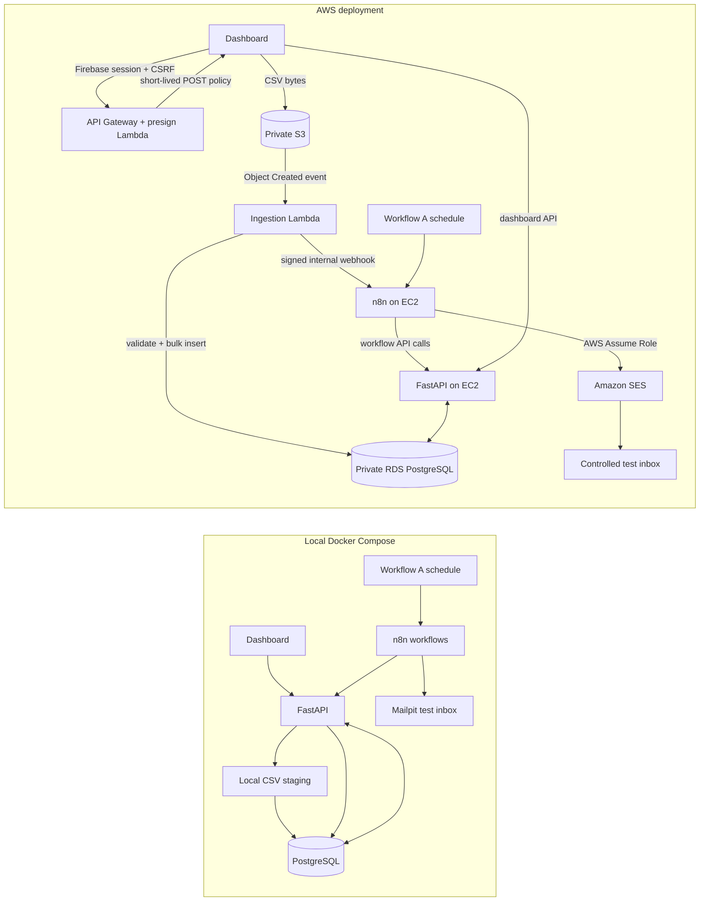

# Loan Eligibility Engine — local operations workspace

The local stack includes a React + Tailwind dashboard, FastAPI, PostgreSQL, n8n, and Mailpit. It supports CSV ingestion, deterministic SQL matching, sourced lender-product data, an optional Gemini-assisted criteria proposal that requires a reviewer, and controlled test notifications.

## 1. Configure Firebase sign-in

The Firebase web app configuration belongs in the local `.env` as `VITE_FIREBASE_*` values. These values identify the client app and are not server credentials. In Firebase Console:

1. Open **Authentication → Sign-in method** and enable **Google** (the UI currently implements Google sign-in).
2. Add `localhost` under **Authentication → Settings → Authorized domains**.
3. In **Project settings → Service accounts**, generate a Firebase Admin SDK private key. Save it as `secrets/firebase-service-account.json`. Keep this JSON private and never commit it; `secrets/` is ignored and mounted read-only into the API container.
4. Set `FIREBASE_PROJECT_ID` to the Firebase project ID and `FIREBASE_BOOTSTRAP_ADMIN_EMAIL` to the verified Google account that should become the first workspace and criteria administrator. This is the app administrator account, separate from the n8n owner account.

The API creates an HttpOnly Firebase session cookie after verifying the ID token and verified email. A first-time Google sign-in automatically creates a private workspace for that user, so individual Firebase user setup or an invitation is not required. Existing workspace invitations still let teammates join an established workspace. The configured bootstrap admin is provisioned automatically and can grant or remove criteria-review access for workspace members; regular workspace admins can invite analysts or viewers in **Team & access**. Criteria approval uses the signed-in platform reviewer role; there is no pasted review token.

## 2. Configure local services

1. Copy `.env.example` to `.env` (or keep your existing `.env`) and set a strong local PostgreSQL password, `N8N_ENCRYPTION_KEY`, Firebase settings above, and a random `N8N_SERVICE_TOKEN` of at least 32 characters. Keep `.env` private.
2. Set `NOTIFICATION_TEST_RECIPIENT=test@clickpe.dev` to enable local test email. Messages go to Mailpit at http://localhost:8025; they are not delivered to the external address and CSV applicant addresses are never used as recipients.
3. Start/rebuild from the project root: `docker compose up --build -d`.
4. Open the dashboard at http://localhost:5173, API docs at http://localhost:8000/docs, n8n at http://localhost:5678, and Mailpit at http://localhost:8025. PostgreSQL is exposed on host port `5433` (container port `5432`).

The API reads Firebase Admin credentials from `/run/secrets/firebase-service-account.json`. The Google provider must be enabled in Firebase Authentication, and the local credential file must be available to the API. A bootstrap admin email is optional; without one, new users still receive private workspaces but no platform-level review access. The Operations screen reports Firebase readiness.

## 3. n8n workflows

For a fresh n8n volume, import and publish all workflows with:

```sh
./scripts/import-n8n-workflows.sh
```

On the AWS host, the script auto-detects `docker-compose.aws.yml`; it stops n8n, imports and publishes all three workflows offline to avoid SQLite locks, then starts n8n so schedules and webhooks register.

The workflows are:

- `product-discovery.json` — daily lender source refresh and criteria-review queue.
- `user-loan-matching.json` — new-batch webhook, set-based SQL matching, and notification handoff.
- `user-notifications.json` — bounded messages delivered through Mailpit locally or SES on AWS.

The local notification branch sends to Mailpit's local HTTP API and needs no SMTP credential. On AWS, `scripts/import-n8n-workflows.sh` creates the n8n AWS Assume Role credential from `N8N_SES_ROLE_ARN` and `N8N_SES_EXTERNAL_ID` in the host `.env`, then assigns it to the SES node. It uses EC2 system credentials, not long-lived keys. The deployed credential now assumes the SES role successfully. The workflows read `N8N_SERVICE_TOKEN` from the n8n runtime environment for internal API calls. Do not put this token into workflow JSON. Recreate/restart n8n after changing `.env` so the container receives the token.

## Dashboard pages

- **Overview:** workspace run counts, applicants, potential matches, attention items, active matching jobs, and recent runs.
- **Runs:** searchable paginated history.
- **Run detail:** accepted/rejected rows, live matching state, event timeline, criteria versions, match outcomes, and bounded notification progress.
- **New upload:** CSV upload progress and automatic navigation to the created run.
- **Products:** published lender criteria, source links, and freshness state.
- **Criteria review:** proposal, evidence quotes, source links, uncertainties, and approve/reject confirmation. Approval validates the proposal hash and current source evidence on the server.
- **Operations:** API-visible database, Firebase Admin, n8n, and the selected local notification transport.
- **Team & access:** invite verified Firebase accounts as analysts or viewers.

## Input and matching contract

CSV columns required: `user_id,name,email,monthly_income,credit_score,employment_status,age`. Uploads are UTF-8 CSV up to 25 MB. Invalid rows are reported per run; identical file content within a workspace reuses the existing batch. The initial sample is `users.csv` (10,000 rows).

Matching uses a database-side candidate filter and idempotent bulk persistence. Applicant data is not sent to Gemini. Missing factors such as employment tenure, salary-account relationship, sector, or net/gross income basis remain explicit follow-up checks. A potential match is not a lender approval or offer. The local example assumes monthly INR and India.

Lender discovery first uses deterministic extraction from configured official sources. Gemini may propose typed criteria only when required product facts cannot be reliably structured deterministically; proposals remain inactive until a platform reviewer approves them. Never commit `LLM_API_KEY`.

## Architecture



The n8n workflows orchestrate discovery, matching, and notifications. The API owns database transactions, row validation, SQL candidate filtering, bulk persistence, and safe test-recipient construction. Workflow B receives only the reduced candidate pairs and public product criteria from the SQL prefilter; its Code node evaluates the remaining rule checks and match status, then the API stores the results in chunks under criteria-version uniqueness. Applicant contact details never enter that matching node, and applicant records are not sent to the LLM. This avoids an LLM call for each user/product pair while keeping the pair-level decision step in n8n.

### Workflow and filtering details

- **Workflow A — discovery:** a daily schedule fetches the allow-listed lender pages (SBI, HDFC, and ICICI), extracts product/rate/eligibility facts, stores deterministic results with source links and freshness, and queues incomplete Gemini-assisted criteria for a human reviewer. Unapproved or stale criteria stay out of matching.
- **Workflow B — matching:** an authenticated batch webhook calls a database-side prefilter for country, currency, employment segment, income floor, age, score, and already-matched criteria versions. An n8n Code node evaluates the reduced pairs, marks potential matches or missing-information cases, and passes results to the API for idempotent chunked persistence.
- **Workflow C — notification:** after matching, the workflow claims a bounded page, creates one test-inbox message per applicant, branches to SES or Mailpit, acknowledges each delivery, and requests another page only when the claim says work remains. The destination comes from `NOTIFICATION_TEST_RECIPIENT`; applicant CSV emails are never used.

The local 10,000-row evidence recorded 6,778 candidate pairs against two verified products, versus 20,000 pairs in a naive all-pairs pass: 66.11% fewer pairs, with 6,778 database inserts in about 2.08 seconds on that local fixture. All saved rows needed additional information because the sample CSV lacks lender-specific fields such as tenure or salary-account relationship. This is a fixture-specific baseline, not an AWS capacity guarantee or a loan approval result. See [PLAN.md](PLAN.md) for the fuller audit and limits.

## AWS deployment mode — deployed short-lived environment

The development deployment is live in `ap-south-1`. It uses API Gateway + Lambda + private S3/RDS for CSV ingestion, with the dashboard/API/n8n containers on a small EC2 host behind Caddy HTTPS. The full topology, current URLs and resource inventory, deployment steps, validation results, capacity limits, and cleanup instructions are in [docs/AWS-DEPLOYMENT.md](docs/AWS-DEPLOYMENT.md).

- Dashboard: https://app.3.109.132.243.nip.io
- API: https://api.3.109.132.243.nip.io (`/api/health`, `/docs`)
- n8n: https://n8n.3.109.132.243.nip.io (`/healthz`)
- Upload presign route: `POST https://api.3.109.132.243.nip.io/uploads/presign` (Caddy proxies to API Gateway so the same-site Firebase session cookie reaches the authorizer)

The Firebase authorized domain is configured and the SES sender is verified. SES remains in sandbox. A live 10,000-row upload completed through S3 → EventBridge → Lambda → RDS → n8n matching: 10,000 accepted, zero rejected, 8,964 potential matches, all needing more information. Workflow C’s SES role credential is configured; a controlled run sent 25 messages to the test inbox and marked 68 match rows sent. The current `nip.io` URLs use an EC2 public IP, not an Elastic IP, so they may change if the instance is stopped and started. This is a demo deployment, not a production capacity/availability configuration.

### Redeploy and clean up

Use `./scripts/deploy-aws.sh` from the repository root with the AWS inputs in `.env`; it handles the ECR image, Serverless stack, EC2 host, Compose services, and workflow import. Do not run a raw `serverless deploy` without the image URI and temporary-credential bridge described in the deployment guide.

When the demo is finished, follow the ordered teardown and data-retention warnings in [docs/AWS-DEPLOYMENT.md](docs/AWS-DEPLOYMENT.md). In particular, removing the Serverless stack deletes its RDS database, while EC2, ECR, Secrets Manager records, and the SES identity require separate cleanup.

## API overview

- `GET /api/health` — basic API/database health and Firebase configuration indicators.
- `GET /api/operations/health` — authenticated service health used by the dashboard.
- `POST /api/auth/session`, `POST /api/auth/logout`, `GET /api/me` — Firebase session exchange and current workspace profile.
- `POST /api/uploads` — local-mode upload endpoint; AWS mode disables it so browsers use S3 direct upload. `GET /api/uploads/by-content/{sha256}` polls the workspace-scoped result after S3 ingestion.
- `GET /api/uploads`, `GET /api/runs`, `GET /api/runs/{batch_id}` — workspace-scoped run history.
- `GET /api/dashboard/summary` — workspace KPI and active-job data.
- `GET /api/products`, `GET /api/products/review-queue`, `POST /api/products/{product_id}/criteria-review` — lender catalog and role-controlled review.
- `/api/workflows/*` — n8n service operations protected by `X-Workflow-Token`; browser actions that start test delivery also require a Firebase session and CSRF check.

## Troubleshooting

- **Sign-in says no workspace:** verify the email matches `FIREBASE_BOOTSTRAP_ADMIN_EMAIL`, or invite that email from an existing workspace administrator.
- **Firebase Admin not configured:** check project ID and the mounted `secrets/firebase-service-account.json`; restart the API after changes.
- **n8n calls return 401:** ensure `.env` has a long random `N8N_SERVICE_TOKEN`, then recreate the n8n and API containers with `docker compose up --build -d api n8n`.
- **n8n SMTP node fails:** recreate/select its Mailpit credential and confirm `mailpit:1025`.
- **No matching workflow starts:** confirm workflow B is active and its production webhook path is `loan-match`.
- **AWS presign returns 401/403:** confirm the Firebase session and CSRF cookie use the configured parent domain, the dashboard origin matches `APP_ORIGIN`, and the signed-in user has analyst/workspace-admin access.
- **AWS upload reaches S3 but no run appears:** check the ingestion Lambda CloudWatch log group and `UploadIngestionDlqUrl` alarm/queue, then verify the API finished its Alembic startup and the worker can reach RDS and the private n8n webhook.
- **AWS SES send fails:** check the imported SES node has an AWS Assume Role credential with system credentials enabled, the EC2 instance has the output profile, and SES verifies the sender/test recipient for the selected Region/account mode.

## Stop and reset

Stop containers with `docker compose down`. `docker compose down -v` permanently deletes local PostgreSQL and n8n volumes. Uploaded source files remain in `uploads/` until removed manually.

## Evaluation commands

Existing evaluation suite (no Gemini calls or email delivery): from `backend/`, install `requirements-dev.txt` and run `python -m pytest evals -q`. The evaluations cover deterministic applicant rules, source-grounded proposal validation/privacy, notification recipient safety, and n8n export topology.
