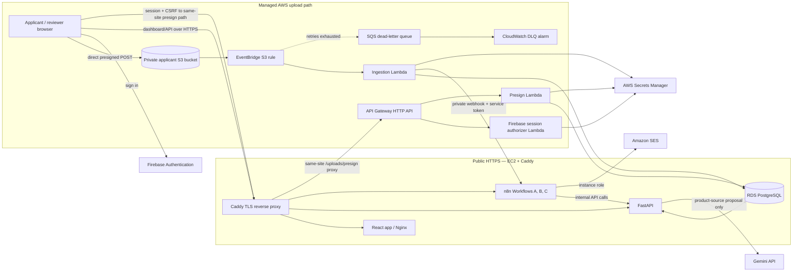
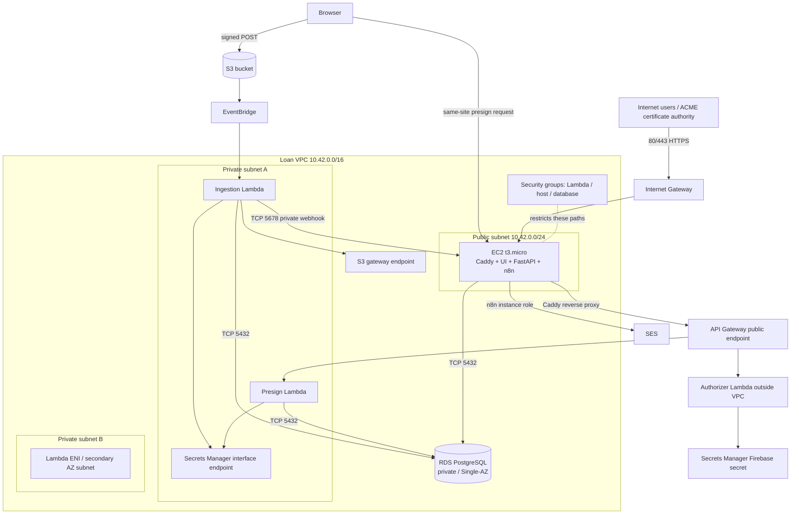
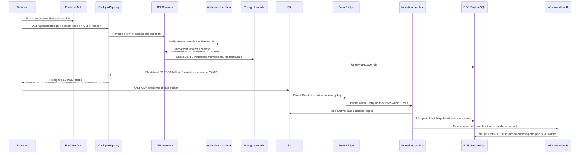

# AWS Deployment — Loan Eligibility Engine

**Deployment record:** 22 October 2026
**Environment:** `dev`, `ap-south-1`
**CloudFormation stack:** `loan-eligibility-engine-dev`
**Status:** infrastructure, upload/matching, n8n AWS role credential, and controlled SES notification delivery verified. Workflow C's paginated test sent 25 messages to the controlled inbox and acknowledged 68 match rows; the rest remain pending.

This document describes what is running now, how the AWS path is wired, how it was deployed, and what is still incomplete. It is grounded in the current Serverless template, AWS Compose file, application handlers, workflows, and live AWS checks; it is not a promise of production capacity.

## Live URLs and endpoints

| Purpose | URL / endpoint | Notes |
| --- | --- | --- |
| Dashboard | [https://app.3.109.132.243.nip.io](https://app.3.109.132.243.nip.io) | React/Vite static app behind Caddy; HTTPS verified. Firebase authorized domain was added for this hostname. |
| API | [https://api.3.109.132.243.nip.io](https://api.3.109.132.243.nip.io) | FastAPI behind Caddy. Health: [`/api/health`](https://api.3.109.132.243.nip.io/api/health); docs: [`/docs`](https://api.3.109.132.243.nip.io/docs). |
| n8n | [https://n8n.3.109.132.243.nip.io](https://n8n.3.109.132.243.nip.io) | Editor and webhook host; health: [`/healthz`](https://n8n.3.109.132.243.nip.io/healthz). Complete n8n owner setup/sign in in the browser if prompted. |
| Presign route used by the browser | `https://api.3.109.132.243.nip.io/uploads/presign` | Same-site API hostname; Caddy proxies this path to API Gateway so the Firebase session cookie is sent. Requires the session cookie, matching CSRF cookie/header, and workspace upload permission. |
| API Gateway upstream | `https://14hffrav0g.execute-api.ap-south-1.amazonaws.com/uploads/presign` | API Gateway HTTP API route. Call it through the Caddy API hostname from the browser; direct browser calls to `amazonaws.com` do not carry the `nip.io` session cookie. |
| S3 bucket | `loan-eligibility-engine-dev-361769587257-ap-south-1` | Private applicant CSV staging; incoming key prefix is `incoming/`. |
| RDS PostgreSQL | `loan-eligibility-engine-dev-loandatabase-y6h03sepneff.ct62ca24wjpm.ap-south-1.rds.amazonaws.com:5432` | Private-only endpoint; reachable only from the application host and Lambda security groups. Do not expose it publicly. |
| n8n matching webhook (private) | `http://10.42.0.227:5678/webhook/loan-match` | Internal VPC address used by the ingestion Lambda. Not a public URL. |

The public IP `3.109.132.243` is **not an Elastic IP**. If the EC2 instance is stopped and started, its public IP and all three `nip.io` URLs can change. Update Firebase authorized domains, Caddy hostnames, `APP_ORIGIN`, and Lambda `N8N_MATCH_WEBHOOK` if that happens. The API Gateway endpoint is independent of that IP.

## What is deployed

| Layer | AWS service / component | Current configuration and role |
| --- | --- | --- |
| Web edge | EC2 `i-0cb308850a3de1a5a`, `t3.micro`, Amazon Linux 2023 | Single public host; 20 GiB gp3 root disk; 2 GiB swap was added for Compose builds. Runs the containers below. No Auto Scaling group or standby host. |
| TLS and routing | Caddy 2 in Docker; `nip.io` hostnames | Caddy terminates HTTPS and reverse-proxies app/API/n8n. Certificates were obtained automatically; TLS verification passed for all three hosts. Public inbound 80/443. |
| UI | React/Vite, Nginx container | Built on the EC2 host with `VITE_UPLOAD_MODE=s3`, Firebase web configuration, and the public API Gateway presign URL. |
| API | FastAPI container on EC2 | Owns normal application operations and PostgreSQL access; runs Alembic migrations during startup. Uses SES notification transport and the configured Gemini key. |
| Workflow orchestration | n8n container on EC2 | Three checked-in workflows imported and published: Workflow A (daily discovery), B (matching webhook), C (controlled notifications). Persistent n8n data is in a Docker volume. |
| Upload front door | API Gateway HTTP API `14hffrav0g` | Firebase-session-authorized `POST /uploads/presign`; CORS allows the deployed dashboard origin. |
| Session verification | Lambda `loan-eligibility-engine-dev-firebaseSessionAuthorizer` | Container image; outside the VPC. Verifies the Firebase session cookie and verified email using Firebase Admin credentials from Secrets Manager. |
| Presigning | Lambda `loan-eligibility-engine-dev-presignUpload` | Container image, 512 MiB / 15 seconds, in private subnets. Checks CSRF and workspace role against RDS and creates a 10-minute presigned S3 POST policy, capped at 25 MiB. |
| CSV ingestion | Lambda `loan-eligibility-engine-dev-ingestS3Upload` | Container image, 1,024 MiB / 120 seconds, in private subnets. Validates the actual uploaded CSV, hashes content, inserts applicants in bounded chunks, and calls the private n8n matching webhook after commit. No reserved concurrency is configured; the account’s default concurrency quota applies. |
| Object storage | Amazon S3 | Block Public Access, SSE-S3, browser CORS for the dashboard, and a seven-day expiration for unprocessed `incoming/` objects. |
| Event delivery | S3 → EventBridge rule → ingestion Lambda | Matches `Object Created` for the configured bucket and `incoming/` prefix. EventBridge retries up to five times for up to one hour. There is no SQS work queue in front of the Lambda. |
| Failure handling | SQS DLQ + CloudWatch alarm | EventBridge sends exhausted events to an encrypted SQS DLQ; message retention is 14 days. CloudWatch alarm watches visible DLQ messages. |
| Relational store | Amazon RDS for PostgreSQL `db.t4g.micro` | PostgreSQL 18.3, 20 GiB gp3 initially, autoscaling storage maximum 100 GiB, encrypted, private, Single-AZ, seven-day backups. RDS generates and manages the master password in Secrets Manager. |
| Network | VPC `10.42.0.0/16` | Public `/24` subnet for EC2; two private `/24` subnets for RDS/Lambdas; Internet Gateway; S3 gateway endpoint; Secrets Manager interface endpoint. No NAT Gateway. |
| Credentials | AWS Secrets Manager | Firebase Admin JSON and n8n service token are separate secrets; RDS master credentials are an RDS-managed secret. The EC2 API’s `.env` also contains the DB password and Gemini key with mode `0600`. |
| Email | Amazon SES | Verified sender identity `shwejannn@gmail.com`; account remains in SES sandbox, and production access is disabled. Keep test destinations on verified inboxes. |
| Container registry | Amazon ECR | `serverless-loan-eligibility-engine-dev`; Lambda image tag `upload-worker` is a single-platform Docker v2 manifest (Lambda-compatible). Scan-on-push is enabled. |
| Identity | Firebase Authentication (external to AWS) | Project `clickpe-3e7ac`. `app.3.109.132.243.nip.io` was added to the authorized domains list. Firebase Admin JSON stays server-side. |
| Logs | Amazon CloudWatch Logs | Lambda log groups use 14-day retention; HTTP API access logs are configured. The DLQ alarm is the configured alert; a full dashboard/on-call setup is not present. |

The EC2 security group allows 80/443 from the internet and 5678 only from the Lambda security group. The deployment temporarily added SSH/22 from the deploying machine’s public IP and removed that ingress rule after setup; a live check found no SSH ingress rule remaining. The instance profile supports Systems Manager and the n8n SES role. **The deployment was administered by temporary, IP-restricted SSH, not SSM Session Manager**; switching routine administration to SSM is still recommended.

### n8n workflows

| Workflow | Trigger | Responsibility |
| --- | --- | --- |
| A — Daily Loan Product Discovery | Daily at 07:00 Asia/Kolkata | Calls the API to fetch/validate official lender sources and loads the criteria-review queue. Gemini proposals remain pending human review. |
| B — User Loan Matching | `POST /webhook/loan-match` on the private n8n listener | Calls FastAPI for SQL candidate reduction, evaluates reduced pairs, and persists the results through the API. The ingestion Lambda supplies the service token. |
| C — Controlled Test Notifications | `POST /webhook/loan-notify` | Requests bounded messages from the API and branches to SES. The `Send through AWS SES` node now has an n8n AWS Assume Role credential using EC2 system credentials. Destinations are restricted to the configured controlled recipient; applicant CSV email fields are not destinations. |

n8n calls FastAPI over the Docker network (`http://api:8000`) for application/data operations. It does not connect directly to RDS. The AWS import helper creates and assigns an `awsAssumeRole` credential for Workflow C using the EC2 system credentials, role ARN, and external ID; no AWS access keys are embedded in the workflow exports.

## Architecture

### Service-level flow

### Network placement

The VPC diagram is conceptual: RDS is a single instance placed in the DB subnet group, not a second database in subnet B. The extra private subnet is for the RDS subnet group and Lambda VPC attachment. No NAT gateway is provisioned; private Lambda service access uses the S3 and Secrets Manager endpoints, while outbound lender-page/Gemini traffic originates from the public EC2 host.

### Applicant upload sequence

## Deployment process (end to end)

The checked-in orchestrator is [`scripts/deploy-aws.sh`](../scripts/deploy-aws.sh). The deployment went through several recoverable configuration failures; the successful path and current fixes are captured below so the next deploy is reproducible.

### Reproduce from the repository root

1. Install the project’s locked dependencies (`npm ci`) and ensure Docker Desktop/Buildx is running.
2. Run `aws login` and select the intended AWS account. Confirm `aws sts get-caller-identity` shows the intended account before provisioning.
3. Copy `.env.example` to `.env` if needed. Set `AWS_REGION=ap-south-1`, `FIREBASE_PROJECT_ID`, `FIREBASE_BOOTSTRAP_ADMIN_EMAIL`, the public `VITE_FIREBASE_*` values, `N8N_SERVICE_TOKEN`, `N8N_ENCRYPTION_KEY`, `SES_FROM_EMAIL`, and `NOTIFICATION_TEST_RECIPIENT`. Put the Firebase Admin service-account JSON at `secrets/firebase-service-account.json`. Optional lender proposal parsing uses `LLM_API_KEY`/`LLM_MODEL`.
4. Run `./scripts/deploy-aws.sh`. It generates/populates the `*_SECRET_ARN` values, creates the ECR image and AWS stack, launches or reuses the tagged EC2 host, writes `.env.aws`, starts the Compose services, and imports/publishes workflows. Click the SES identity verification link when it arrives.
5. Visit the dashboard URL printed by the script, finish Firebase/n8n browser setup if prompted, and use the acceptance checklist in this document. Do not paste secrets into terminals that record history or into chat.

The script discovers the EC2 public IP and generates `APP_ORIGIN`, `N8N_MATCH_WEBHOOK`, the three `nip.io` hostnames, and `UPLOAD_API_DOMAIN` from stack outputs. RDS credentials and secret ARNs are generated/managed by AWS; do not pre-fill them with copied credentials.

1. **Choose the AWS account and region.** The deployed account is `361769587257`; region is `ap-south-1`; stage is `dev`. `aws login` provides temporary credentials. The script explicitly selects the default login profile, exports refreshed credentials for Serverless, and refreshes before each Serverless invocation. The observed principal was the account root principal; use a dedicated least-privilege role/Identity Center access rather than root for ongoing or production operations.
2. **Prepare local inputs.** Keep `.env` and `secrets/firebase-service-account.json` out of git. Required inputs include Firebase project/admin identity and public web config, `N8N_SERVICE_TOKEN`, `N8N_ENCRYPTION_KEY`, SES sender/test recipient, and optional `LLM_API_KEY`. `.env.example` lists the inputs. Never place secret values in this document or workflow JSON.
3. **Create/verify secret records and SES sender.** The script creates or reuses Firebase Admin and n8n token secrets in Secrets Manager. The RDS master password is generated and managed by RDS. The SES email identity must be verified by clicking the email link; this sender is verified now, but the SES account is still sandboxed.
4. **Build and publish the Lambda image.** The script ensures the ECR repository exists, uses Docker Buildx for `linux/amd64` with provenance disabled, exports a single-platform Docker image, pushes it to ECR, and rejects image-index manifests. This was necessary because Lambda rejected the initial OCI image index. If the existing tag has a supported single-image manifest, the script reuses it rather than rebuilding.
5. **Deploy the managed stack.** Serverless Framework v3 deploys `serverless.yml`: VPC/subnets/routes/endpoints/security groups, RDS, S3, API Gateway, three Lambda functions and roles, EventBridge rule, SQS DLQ/policy, CloudWatch alarm/log groups, Secrets references, and the n8n EC2 instance profile. Serverless v3 is pinned in the workspace package dependencies.
6. **Create/reuse the EC2 host and configure the second pass.** The script creates/reuses key pair `loan-engine-dev`, launches/reuses the tagged `t3.micro` in the public subnet, obtains its current public/private IPs, writes the private n8n webhook and HTTPS dashboard origin into `.env`, then redeploys Lambda environment configuration. It writes `.env.aws` (mode `0600`) with RDS credentials and app settings; this file is git-ignored.
7. **Ship the app and start Docker Compose.** The script opens SSH/22 only from the deployment machine’s current public IP, transfers the source/config and Firebase file, installs Docker Compose, configures 2 GiB swap, and starts `docker-compose.aws.yml`. A trap removes the temporary SSH ingress on script exit. Caddy issues HTTPS certificates for the `nip.io` names. The host runs frontend, API, n8n, and Caddy; PostgreSQL remains in RDS.
8. **Import and publish workflows.** `scripts/import-n8n-workflows.sh` stops n8n and performs credential/workflow import and publish commands offline against its SQLite volume to avoid `SQLITE_BUSY`, then starts n8n. When `N8N_SES_ROLE_ARN` and `N8N_SES_EXTERNAL_ID` are present in the host `.env`, it creates the AWS system-role credential and binds it to Workflow C’s SES node. The AWS host helper auto-detects `docker-compose.aws.yml`.
9. **Configure Firebase and verify.** The Firebase Authentication authorized domain `app.3.109.132.243.nip.io` was added to project `clickpe-3e7ac`. Live checks returned HTTP 200 with valid TLS for app/API/n8n; `/api/health` reported API, database, and Firebase ready; `n8n /healthz` returned 200; API Gateway CORS preflight returned 204 for the dashboard origin.

### Deployment troubleshooting decisions

- Serverless v3 must be installed locally; the global/latest v4 CLI rejected `frameworkVersion: '3'`.
- Serverless v3 does not accept the original ECR `maxImages`/`buildOptions` configuration. The deployment now uses an explicit prebuilt ECR URI and a separate supported Buildx image build.
- S3 EventBridge notifications require `EventBridgeConfiguration.EventBridgeEnabled: true`.
- The SES identity was created out-of-band for email verification, so it was removed as a duplicate CloudFormation resource.
- The account’s Lambda concurrency quota rejected a `reservedConcurrency: 5` setting. It was removed; the functions use the account’s default unreserved concurrency.
- AWS `login_session` credentials are not understood by the bundled Serverless SDK. `aws configure export-credentials --profile default --format env` is used to bridge/refresh them.
- The EC2 Docker package did not include Compose; the pinned Compose plugin is installed on host bootstrap.
- Publishing while n8n ran caused SQLite locking. The checked-in import script now stops n8n and runs the CLI offline.
- A direct browser request to the `execute-api` hostname returned 401 because browser cookies for the `nip.io` app/API cannot be sent to `amazonaws.com`. Keep the Lambda authorizer enabled; the browser now calls the same-site API hostname and Caddy proxies only `/uploads/presign` to API Gateway. One authenticated request returned 500; the later 10,000-row upload succeeded. HTTP API access logs now include integration and gateway error details if this recurs.

## Validation status

| Check | Result |
| --- | --- |
| CloudFormation stack and managed resources | `UPDATE_COMPLETE`; S3, RDS, API Gateway, Lambda, EventBridge, SQS, IAM, VPC resources present. |
| RDS | `available`; private, encrypted PostgreSQL 18.3 `db.t4g.micro`; API health reports database ready. |
| Lambda functions | Three functions `Active`; presign, authorizer, and ingestion settings deployed. The ingestion webhook is `http://10.42.0.227:5678/webhook/loan-match`. |
| ECR image | ECR reports `application/vnd.docker.distribution.manifest.v2+json` for `upload-worker`. |
| Public web health | App/API/n8n each returned HTTP 200 over certificate-verified HTTPS. |
| Upload CORS/proxy | Caddy-proxied API Gateway preflight returned HTTP 204 for `https://app.3.109.132.243.nip.io`; app and API share the cookie domain, so the browser can send the session cookie to the authorizer. |
| Firebase authorized domain | Added successfully for the dashboard hostname. |
| SES identity and workflow credential | Sender verified; SES production access is false (sandbox). The AWS Assume Role credential is imported and bound to the SES node; role assumption and a controlled SES run succeeded. |
| Workflow files | All three imported and published; n8n health endpoint returned HTTP 200. |
| Upload and matching | **Runtime verified on one live 10,000-row batch** (`08825246-8b61-40af-b039-a9a7b1c1d0c4`): 10,000 accepted, zero rejected, 8,964 candidate pairs/matches persisted. All matches are `needs_information`, not approvals. |
| Notification delivery | Workflow C sent 25 test messages to the controlled inbox and marked 68 match rows `sent_to_test_inbox`; 8,896 match rows remain pending. No CSV email addresses were used as destinations. |

## Capacity, security, and known gaps

This deployment is suitable for a temporary demo and small test batches, not a production workload guarantee:

- Event-driven S3 ingestion can add Lambda workers as events arrive, but no reserved concurrency is set (the account quota prevented the intended value). The EventBridge rule invokes Lambda directly; SQS is only a dead-letter queue, not a buffering work queue.
- RDS is a small Single-AZ instance. Storage can grow from 20 GiB to 100 GiB, but compute, connections, and failover are not production-scaled. No RDS Proxy, Multi-AZ, or load test is configured.
- The API, frontend, and n8n share one `t3.micro` EC2 host. It is a single point of failure and has limited CPU/memory; 2 GiB swap is a build safeguard, not added RAM or horizontal scaling.
- No Elastic IP or owned DNS domain exists. The `nip.io` URLs follow the current public IP. Caddy HTTPS works now, but the address is not stable across stop/start.
- The deployment has a DLQ alarm and Lambda/API logs, but no full dashboard, notification routing, load test, or backup-restore drill.
- Account access used a root principal through `aws login`. Replace with least-privilege developer access and MFA before keeping this environment long term.
- The Gemini API key was pasted into chat and is present in the EC2 `.env`; rotate it and update the host environment. Prefer storing it in Secrets Manager rather than a long-lived plaintext environment file.
- n8n is internet-facing behind HTTPS. Finish owner-account setup and restrict editor access to trusted users; the n8n instance role can send through SES.
- SES remains sandboxed. The sender is verified; recipient identities must also be verified until SES production access is granted.

### Next acceptance and hardening tasks

1. Repeat the successful upload with a small synthetic CSV and confirm duplicate/retry idempotency; inspect EventBridge/Lambda logs and the DLQ after a controlled failure.
2. Run Workflow A once and verify product freshness/review queue; do not assume Gemini succeeds just because the app health checks pass.
3. Check the controlled inbox (and spam folder) for the 25 SES test messages. The successful workflow execution and database acknowledgments confirm SES accepted the sends. Do not trigger more pages unless additional test messages are wanted; never email applicant addresses.
4. Rotate the exposed Gemini key and keep the replacement private; update the running API. Finish n8n owner setup and verify Firebase sign-in from the hosted dashboard.
5. Replace temporary nip.io addressing with an owned domain/stable address if the environment will persist. Switch administration to SSM, use a non-root AWS identity, set an AWS Budget, and review ingress/credential policies.
6. For higher volume, load-test representative files; introduce an SQS work queue and size Lambda concurrency together with RDS capacity (or RDS Proxy); then consider Multi-AZ and a horizontally scaled/managed app host.
7. When the demo is over, back up any wanted data, remove the EC2 host and stack resources, then explicitly clean up the separately created ECR repository, Secrets Manager secrets, key pair, and SES identity as appropriate. See cleanup notes below.

## Stop, cleanup, and cost safety

This is a live AWS environment; EC2, RDS, EBS, public IPv4, VPC interface endpoint, Secrets Manager, ECR storage, and data transfer can continue to incur charges. For a short pause, stop the EC2 instance and understand that the public IP/URLs may change; stopping does not stop RDS or all storage/endpoint charges.

For full teardown, first export any required records and confirm the data can be destroyed. Then:

1. Stop the host containers and terminate EC2 instance `i-0cb308850a3de1a5a`; delete the EC2 key pair `loan-engine-dev` and local `scripts/loan-engine-dev.pem` when no longer needed.
2. Empty the applicant upload bucket and any Serverless deployment bucket only after confirming their contents are disposable.
3. Remove the Serverless stack (`npx serverless remove --stage dev --region ap-south-1`) with refreshed deployment credentials. **The RDS resource has `DeletionPolicy: Delete`; deleting the stack deletes the database.**
4. Delete the separately managed ECR repository `serverless-loan-eligibility-engine-dev`, Firebase/n8n secrets under `loan-engine-dev/`, and SES identity if no longer required. Check CloudFormation, EC2, S3, RDS, ECR, Secrets Manager, SES, and billing afterward for leftovers.

The complete deployment plan and remaining assignment actions are tracked in [`PLAN.md`](../PLAN.md). Local Docker Compose usage remains documented in [`README.md`](../README.md).
