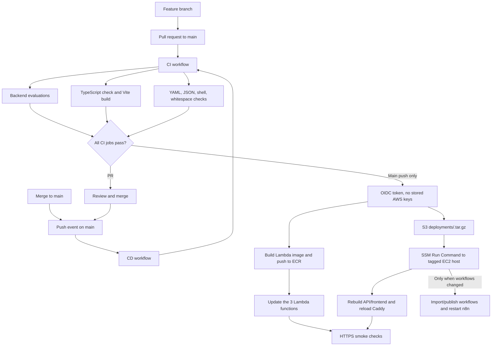

# GitHub Actions CI/CD

## Workflow split and triggers

The repository keeps continuous integration and continuous delivery in separate workflows:

- [`ci.yml`](../.github/workflows/ci.yml) runs for **every pull request targeting `main`** and is reusable by CD. It has read-only repository access and no AWS credentials.
- [`cd.yml`](../.github/workflows/cd.yml) runs on **every push to `main`**, calls the CI workflow as a required job, then deploys only after those checks pass.



## CI checks

`ci.yml` has three required-to-pass jobs:

1. **Backend tests:** Python 3.11; install `backend/requirements-dev.txt`; run `PYTHONPATH=backend python -m pytest backend/evals -q`.
2. **Frontend build:** Node 22; `npm ci` in `frontend/`; run `npm run build` (TypeScript and Vite production build).
3. **Configuration validation:** parse Serverless/Compose/CloudFormation YAML and exported n8n JSON, check shell syntax, and check the commit diff for whitespace errors.

Pull-request workflows do not request `id-token: write`, so unmerged code cannot assume the AWS deployment role.

## CD behavior on `main`

On each `main` push, `cd.yml` calls the CI workflow and runs only if that reusable CI job succeeds:

1. Checks out the exact commit that passed CI and assumes the AWS role through GitHub OIDC.
2. Builds `backend/Dockerfile.lambda` as a single `linux/amd64` Docker v2 image with Buildx provenance disabled. It pushes to ECR as `upload-worker` and rejects an OCI index/manifest list, which Lambda cannot use.
3. Updates the Firebase authorizer, presign, and ingestion Lambda functions to that image and waits for each update to complete.
4. Packages the backend, frontend, workflows, deployment scripts, AWS Compose file, and Caddyfile. It excludes `.env*`, Firebase keys, uploads, `node_modules`, `.git`, and `.pem` files.
5. Uploads the archive to the private S3 bucket at `deployments/<commit-sha>.tar.gz`. A lifecycle rule expires deployment archives after 14 days; the S3 event rule only watches `incoming/`.
6. Sends a Run Command to the tagged EC2 host through Systems Manager. The host downloads the archive using its instance profile, rebuilds/restarts the API and dashboard containers, and restarts Caddy. If workflow JSON changed, it imports/publishes the workflows through the SQLite-safe helper.
7. Smoke-checks API health and n8n health over HTTPS.

The SSM deployment uses the existing instance and Compose `.env`; it does not copy or replace secrets. The host security group does not need public SSH for CD.

## OIDC bootstrap and permissions

`infra/github-actions-deploy-role.yml` defines the GitHub OIDC provider and role. `scripts/setup-github-actions-oidc.sh` creates/updates that stack after AWS login and resolves the live bucket and EC2 instance. The role trusts only:

```text
repo:shwejan005/clickpe:ref:refs/heads/main
```

It has scoped permissions for the one ECR repository, three Lambda functions, the `deployments/` S3 prefix, and SSM commands to the one EC2 instance. It has no IAM, CloudFormation, Secrets Manager, or SES permissions. The workflow uses the role ARN directly; there are no static AWS access keys or GitHub AWS secrets.

The EC2 instance profile can read only the `deployments/` prefix in addition to its existing SES/SSM permissions. Applicant CSV objects under `incoming/` are not granted to the host role.

### Bootstrap order

The CI/CD role cannot update CloudFormation or IAM. Bootstrap the deployed dev environment from a trusted local AWS session:

1. Run `./scripts/setup-github-actions-oidc.sh` to create the GitHub OIDC provider and scoped deploy role.
2. Run `./scripts/deploy-aws.sh` once to apply the `deployments/` lifecycle and EC2 instance-role S3 read policy in `serverless.yml`.
3. Push the feature branch and open a PR. CI runs without AWS permissions.
4. Merge after CI passes. The successful main push triggers CD through OIDC.

## Scope and operational boundaries

- CI/CD automatically deploys **application/Lambda code and changed workflow definitions** on main pushes.
- Changes to VPC, RDS, IAM policies, routes, or other CloudFormation resources are **not** applied by the GitHub role. Review and deploy those deliberately with `scripts/deploy-aws.sh`; this keeps broad infrastructure privileges out of the CI role.
- If a workflow definition changes, the import helper stops n8n briefly, reimports/publishes all three workflows, and starts it again. Code-only deploys do not interrupt n8n.
- The live environment is a temporary demo stack: one `t3.micro`, one Single-AZ `db.t4g.micro`, account-default Lambda concurrency, and no load/restore drill. The pipeline does not make it production-HA or prove high-volume capacity.
- The current `nip.io` hostnames depend on the EC2 public IP. If that IP changes, update the app origin, Firebase authorized domain, and health-check URLs before the next release.

## End-to-end verification

For a PR, verify the **CI** workflow passes all three jobs. After merge, verify the follow-up **CD** run:

- Lambda image manifest validation and all three function updates pass.
- SSM command completes successfully and reports the expected Compose deployment.
- `https://api.3.109.132.243.nip.io/api/health` returns `status: ok`.
- `https://n8n.3.109.132.243.nip.io/healthz` returns HTTP 200.
- For application acceptance, use a synthetic CSV and the controlled SES inbox as described in [AWS-DEPLOYMENT.md](AWS-DEPLOYMENT.md).

GitHub checks do not send applicant notifications as part of CI. CD only runs application deployment and smoke checks; it does not trigger workflows that send email.
